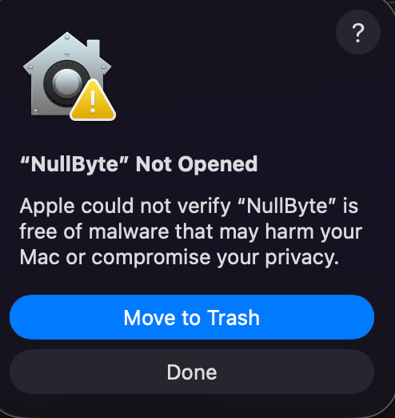

# NullByte — AI Coding Assistant


NullByte is a lightweight Electron-based desktop tool that gives you instant access to Google's Gemini AI while you code. It sits on top of your IDE, browser, or terminal as a non-intrusive floating panel — perfect for quick code explanations, debugging help, and on-the-fly learning.

> **⚠️ Disclaimer:** NullByte is designed as a **personal productivity and learning tool**. It is **not** intended for use during interviews, exams, proctored assessments, or any scenario where external assistance is prohibited. Please use this tool ethically and responsibly.

## ✨ Features

- **Always-On-Top Panel** — A floating panel that stays visible over your IDE, browser, or any other application so you can reference AI-generated solutions without switching windows.
- **Click-Through Mode** — The panel doesn't interfere with your workflow; mouse events pass through to the application underneath.
- **Global Hotkeys** — Control everything via keyboard shortcuts without leaving your current app.
- **Gemini AI Integration** — Leverages Google's latest multimodal AI models for intelligent code analysis and solutions.
- **Screenshot & Solve** — Capture a portion of your screen (error messages, code snippets, UI bugs) and let AI analyze it instantly.
- **Secure API Key Storage** — Your Gemini API key is stored with encryption on your local machine.

## 🚀 Getting Started

### 1. Install via Homebrew (macOS)
The fastest way for macOS users to install NullByte and keep it updated is through our custom Homebrew tap:

```bash
brew tap 101yogeshsharma/nullbyte
brew install nullbyte
```

> [!CAUTION]
> ### ⚠️ macOS Security Note
> Because NullByte is currently an unsigned developer tool, macOS will block it from opening the first time with a "Apple could not verify..." warning.
>
> 
>
> **To fix this, you have two options:**
>
> 1. **Terminal (Deep Clean):** Open your terminal and run the following command to remove the quarantine tag:
>    ```bash
>    xattr -d com.apple.quarantine /Applications/NullByte.app
>    ```
> 2. **System Settings:** 
>    - Go to **System Settings** > **Privacy & Security**.
>    - Scroll down to the **Security** section.
>    - Click **Open Anyway** next to the NullByte block notice.

*Note: You may be prompted to allow the application to open since it is an unsigned release currently.*

### 2. Install via Winget (Windows)
Windows users can soon install NullByte natively via Microsoft's Winget package manager!

```bash
winget install NullByte
```
*(Note: NullByte relies on central submission to `microsoft/winget-pkgs`. If the latest release isn't available immediately, give the pull request a few hours to merge).*

### 3. Manual Installation (Windows/Linux/Mac)

#### Prerequisites

Make sure you have the following installed on your machine:

| Tool | Version | Download |
|---|---|---|
| **Node.js** | v18 or higher | [nodejs.org](https://nodejs.org/) |
| **NPM** | Comes with Node.js | — |
| **Git** | Any recent version | [git-scm.com](https://git-scm.com/) |

#### Clone the Repository

```bash
git clone https://github.com/101yogeshsharma/NullByte.git
cd NullByte
```

#### Install Dependencies

```bash
npm install
```

### 3. Configure an AI Provider (Gemini, OpenRouter, or Ollama)

NullByte works out of the box with **Google Gemini** (defaulting to **Gemini 4 Hydrogen**, available on Google AI Studio's Free Tier) and also supports **OpenRouter** free vision models and **Ollama** local models:

1. **Google Gemini (Default):** Go to [Google AI Studio](https://aistudio.google.com/), sign in, click **"Create API Key"**, and copy the full key (`AQ...` or `AIza...`) using the **Copy key** button.
2. **OpenRouter (Optional Free Alternative):** Create a key at [openrouter.ai/keys](https://openrouter.ai/keys) and select **OpenRouter** in NullByte **Settings** to use free vision models without Google Cloud billing.
3. **Ollama (Local / Offline):** Run [Ollama](https://ollama.com/) locally with a vision model (e.g., `ollama pull qwen2.5vl` or `ollama pull gemma3`) and choose **Ollama** in **Settings**.

> **Note:** Models in NullByte are fetched dynamically on startup and tagged as **FREE**, **PAID**, or **LOCAL** (deprecated/retired models are automatically hidden). You can click **Test Key / Connection** in **Settings** anytime to verify credentials and quota.

### 4. Run in Development Mode & Tests

```bash
npm test
npm run start
```

This launches NullByte directly. You can also use:

```bash
npm run dev
```

### 5. Build for Production

To create a standalone installer that you can share or install on any machine:

```bash
# To build macOS (.dmg)
npm run build:mac

# To build Windows (.exe)
npm run build:win
```

The output installers will be placed in the `dist/` folder.

> **💡 Tip for Git Bash / WSL users:** You can also use the included build script:
> ```bash
> chmod +x build.sh
> ./build.sh
> ```
> It handles dependency checks, cleans previous builds, and creates the `.exe` in one step.

## 📁 Project Structure

```
NullByte/
├── main.js                 # Electron main process — window creation, hotkeys, AI orchestration
├── modelCatalog.js         # Model curation, deprecation filtering, Free/Paid tagging & errors
├── providerClient.js       # Gemini, OpenRouter, and Ollama API clients
├── preload.js              # Preload script — bridges main ↔ renderer securely
├── renderer/               # Frontend UI files
│   ├── overlay.html        # Floating overlay UI
│   ├── settings.html       # Provider, model & API key test settings
│   └── setup.html          # Initial onboarding window
├── assets/                 # App icons (PNG / macOS ICNS / Windows ICO)
├── build/                  # Installer config & scripts
├── test/                   # Automated unit tests (`npm test`)
├── verify_key.js           # Gemini API key validation CLI utility
├── electron-builder.yml    # Electron Builder configuration
├── package.json            # Project metadata and scripts
└── build.sh                # Bash build helper script
```

## 🎮 Usage

1. **Launch** NullByte.
2. **Configure a Provider** — Enter a Google Gemini API key (`AQ...` / `AIza...`) from [Google AI Studio](https://aistudio.google.com/), or choose **OpenRouter** / **Ollama** in Settings.
3. **Use keyboard shortcuts** to interact with NullByte:

| Shortcut | Action |
|---|---|
| `Ctrl + Shift + S` | Capture a screenshot (adds to queue) |
| `Ctrl + Shift + G` / `Ctrl + Shift + Enter` | Solve with AI |
| `Ctrl + Shift + D` | Solve (alternative shortcut) |
| `Ctrl + Shift + Q` | Toggle NullByte visibility |
| `Ctrl + Shift + X` | Clear screenshot queue |
| `Ctrl + Shift + M` | Toggle AI model selection |
| `Ctrl + Shift + Arrow Keys` | Scroll through the solution |

4. **Workflow**: Capture a screenshot of a coding problem or error → press Solve → read the AI-generated explanation and solution right in NullByte.

## 🔧 Technical Details

- **Always-On-Top Window** — Built as an Electron `BrowserWindow` with `alwaysOnTop` enabled, using a frameless, transparent design for minimal visual footprint.
- **Click-Through** — Uses Electron's `setIgnoreMouseEvents` API so the tool doesn't block interaction with underlying apps.
- **Compact UI** — Uses a toolbar-style window to keep the interface minimal and out of the way.
- **Self-Hiding Capture** — NullByte temporarily hides before taking screenshots to ensure clean captures of the content beneath it.

## 🎨 Customization

- **Icon** — Replace `assets/icon.png` with your own 512×512 PNG.
- **Theme** — Edit the styles in `renderer/overlay.html` to customize colors, fonts, and layout.

## ❓ Troubleshooting

| Problem | Solution |
|---|---|
| `npm install` fails | Make sure you have Node.js v20+ installed. Run `node -v` to check. |
| NullByte doesn't appear | Press `Ctrl + Shift + Q` to toggle visibility. Check if the app is running in the system tray. |
| "Invalid API Key" error | Use the **Copy key** button in [Google AI Studio](https://aistudio.google.com/) and test it with **Test Key** in Settings. |
| Paid model / `limit: 0` error | Switch to a **FREE**-tagged model (like **Gemini 4 Hydrogen** or **Gemma 4**), or switch to **OpenRouter** / **Ollama** in Settings. |
| Build fails with privilege errors | Run your terminal as **Administrator** and try again. |
| Screenshots are blank | Make sure you're not running the app in a virtual machine, as some VMs restrict screen capture APIs. |

## 🤝 Contributing

Contributions are welcome! Here's how you can help:

1. **Fork** this repository.
2. **Create a branch** for your feature or fix:
   ```bash
   git checkout -b feature/your-feature-name
   ```
3. **Make your changes** and commit them:
   ```bash
   git commit -m "Add: your feature description"
   ```
4. **Push** to your fork:
   ```bash
   git push origin feature/your-feature-name
   ```
5. **Open a Pull Request** against the `main` branch of this repository.

### Ideas for Contributions
- 🐛 Bug fixes and stability improvements
- 🎨 UI/UX enhancements
- 🌐 Multi-platform support (macOS, Linux)
- 📝 Documentation improvements
- ✨ New AI model integrations

## 📄 License

This project is licensed under the Apache License 2.0 — see the [LICENSE](LICENSE) file for details.

